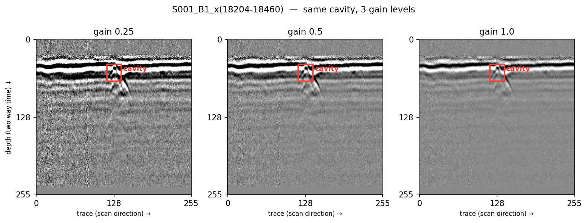

# 공간지능 및 멀티모달 AI 기반 다중 사회기반시설 진단·유지관리 기술 개발


## 1차년도 데이터셋 — GPR 지하 공동 B-scan + 기상 정보 (비식별화본)

서울 지역을 지표투과레이더(GPR)로 탐사해 얻은 **지하 공동(cavity) B-scan 이미지 7,376장**과, 이미지마다 하나씩 있는 **XML 7,376개**입니다.
XML에는 공동 위치(bounding box), 크기 같은 라벨과 함께, 탐사 당시 기상과 탐사 지점의 장기 강수·동결융해·적설 정보가 들어 있습니다.

---

## 1. 한눈에 보기

| 항목 | 값 |
|---|---|
| 이미지 | 7,376장 (JPEG, 256×256, 흑백 1채널) |
| 라벨 | XML 7,376개 (Pascal VOC 형식 + 확장 블록), 이미지당 객체 1개 |
| 클래스 | `cavity` 1종 (`cavityclass=A`, 대칭형) |
| 탐사(측정) 횟수 | 317회 (`S001`–`S317`) |
| 서로 다른 공동 구간 | 520개 (탐사 ID + 구간 `x(...)` 기준) |
| 탐사 지점 | 308곳 (`site_id`), 서울 25개 자치구 |
| 장비 | MA 6,944장 (탐사 284회, 24·25채널) / DS 432장 (탐사 33회, 15채널) |
| 게인(gain) | 0.25 / 0.5 / 1.0 (각 약 2,460장) |
| 계절 | 가을 4,500 · 겨울 2,196 · 여름 372 · 봄 308 |
| 노면 | 아스팔트(`Asphalt`), 유전율 6.0 |
| 용량 | 약 298MB (이미지 240MB, XML 58MB) |

> **주의: 같은 공동이 여러 장으로 들어 있습니다.**
> 같은 공동 구간 하나를 여러 채널(`B#`)과 3가지 게인(`g#`)으로 잘라 만든 이미지들이라, 7,376장은 실제로는 약 520개 공동 구간에서 나왔습니다.
> 학습/검증/평가로 나눌 때는 **탐사 ID(`S###`) 단위로 묶어서** 나누어야 같은 공동이 양쪽에 섞이지 않습니다. (아래 5절 예시 참고)

## 2. 예시



`S001_B1_x(18204-18460)` 구간을 게인 0.25 / 0.5 / 1.0으로 만든 이미지 3장이며, 빨간 상자는 XML의 `object/bndbox`입니다.

- **이미지 읽는 법**: 가로축은 장비가 이동한 방향의 트레이스(측정 지점) 256개, 세로축은 전파가 되돌아오기까지 걸린 시간으로 아래로 갈수록 깊습니다. 위쪽의 굵은 흑백 가로줄은 지표면·포장층 경계에서 반사된 신호입니다.
- **공동의 모습**: 상자 안쪽에서 시작해 아래로 퍼지는 **쌍곡선(∧ 모양)** 반사가 공동 신호입니다. 주변 매질과 공동 안 공기의 유전율 차이 때문에 강한 반사가 생깁니다. 라벨 상자는 쌍곡선의 꼭대기 부분을 감쌉니다.
- **게인 차이**: 같은 원본 신호를 대비만 다르게 만든 것이라 공동 위치와 상자는 3장 모두 같습니다. 게인 0.25에서는 깊은 쪽 잡음까지 진하게 보이고, 1.0에서는 강한 반사만 두드러집니다.
- **같은 이미지의 XML 값** (게인 0.5 기준, 일부)

  | 구분 | 값 |
  |---|---|
  | 장비 / 채널 | MA, 25채널 중 1번 |
  | bbox (픽셀) | xmin 116.1, ymin 40.7, xmax 140.1, ymax 68.9 |
  | 공동 크기 `w, l, h` | 0.9, 1.1, 0.32 |
  | 탐사 계절 / 지역 | 여름 / 관악구 (`site_id` L116) |
  | 탐사 시 기온·습도 (원본) | 27.6 °C, 66.4 % |
  | 탐사 시각 기온, 24시간·7일 강수 (ASOS 108) | 28.7 °C, 0.1 mm, 5.1 mm |
  | 최근접 관측소 1년 누적강수 / 50mm 이상 호우일수 | 913.0 mm / 2일 (관측소 509) |
  | 지난 겨울 동결융해일수 / 신적설 합 | 63일 / 15.1 cm |

## 3. 폴더 구조

```
.
├── README.md
├── assets/   README용 예시 그림
├── images/   GPR B-scan 7,376장 (*.jpg)
└── xml/      라벨·메타데이터 7,376개 (*.xml, 파일명 stem 이 이미지와 같음)
```

### 파일명 규칙

`S###_B<채널>_g<게인>_x(<시작>-<끝>).jpg`

| 부분 | 뜻 |
|---|---|
| `S###` | 탐사(측정 1회) 단위의 무작위 ID. 번호 순서는 시간 순서와 무관합니다. |
| `B<채널>` | 다채널 GPR의 채널 번호 (B-scan 층) |
| `g<게인>` | 이미지 생성 시 적용한 게인 (0.25 / 0.5 / 1.0) |
| `x(<시작>-<끝>)` | 원본 B-scan에서 잘라낸 수평(주행 방향) 트레이스 구간. 폭은 항상 256입니다. |

## 4. XML 구성

```xml
<annotation>
  ...원본 라벨...
  <season>autumn</season>
  <object> ... <bndbox/> <cavity_size/> </object>
  <metadata_v2> ... </metadata_v2>
  <kma_weather> ... </kma_weather>
  <kma_rain_snow> ... </kma_rain_snow>
</annotation>
```

### 4.1 원본 라벨 부분

| 필드 | 설명 |
|---|---|
| `filename`, `localpath`, `folder` | 이미지 파일명, 원본 라벨링 도구의 경로(파일명은 비식별화된 이름), 공동 형상 폴더(`대칭형`) |
| `size/width,height,depth` | 256, 256, 1 |
| `equipment`, `channels`, `channellayer` | 장비 코드(MA/DS), 전체 채널 수, 이 이미지의 채널 |
| `gainvalue`, `scanclass` | 게인, 스캔 종류(`B`) |
| `season` | 탐사 계절: spring 3–5월, summer 6–8월, autumn 9–11월, winter 12–2월 |
| `address` | 원본 데이터의 지역 코드 (`SA`–`SY`, 2글자) |
| `temphum` | 탐사 시 `기온(°C),습도(%)` (원본 제공값) |
| `rainfall` | 탐사 전 3일 강수 `d-2,d-1,d0` (원본 제공값) |
| `permittivity`, `roadtype` | 유전율(6.0), 노면 종류(Asphalt) |
| `object/name`, `cavityclass` | `cavity`, `A` |
| `object/bndbox` | `xmin, ymin, xmax, ymax` (픽셀, 소수점 포함). 모두 0 ≤ min < max ≤ 256 입니다. |
| `object/cavity_size/w,l,h` | 원본에 기록된 공동 크기 (중앙값 w 1.2, l 1.2, h 0.27) |

### 4.2 `<metadata_v2>` — 데이터 제공처 메타데이터

`record_id`(무작위 재부여), `equipment_code`, `scan_no`, `channel_no`, `gain`, `segment_range`, `temperature_c`, `relative_humidity_pct`, `rainfall_3d`, `marking_x`, `marking_y`, `marking_code`(이미지 안 공동 표시점의 픽셀 좌표), `facility_type`(`road`), `modality`(`GPR`), `damage_type`(`cavity`) 등.
대부분 원본 라벨과 같은 내용을 정리된 이름으로 다시 담은 것입니다.

### 4.3 `<kma_weather>` — 탐사 시각의 서울 기상 (29개)

기상청 API허브 **ASOS 108번(서울)** 시간자료를 탐사 시각에 맞춰 붙였습니다. 모든 이미지가 같은 관측소를 쓰므로 지역 차이는 반영되어 있지 않습니다.

| 그룹 | 필드 |
|---|---|
| 탐사 시각 관측값 | `asos_ta` 기온, `asos_td` 이슬점, `asos_hm` 습도, `asos_ws`/`asos_wd` 풍속·풍향, `asos_pa` 기압, `asos_ts_surface` 지면온도, `asos_te_5cm`–`asos_te_30cm` 지중온도, `asos_snow_depth` 적설깊이, `asos_rn_1h` 1시간 강수 |
| 직전 24시간 | `asos_rn_24h`, `asos_ta_min_24h`, `asos_ta_max_24h`, `asos_ta_mean_24h`, `asos_ss_24h` 일조, `asos_si_24h` 일사 |
| 누적 강수 | `asos_rn_3d`, `asos_rn_7d`, `asos_rn_14d`, `asos_rn_30d`, `asos_rn_max1h_7d`, `asos_rn_max1h_30d`, `asos_hours_since_rain` |
| 동결 | `asos_freeze_thaw_days_30d` 30일 동결융해일수, `asos_frost_days_30d` 30일 서리일수 |

### 4.4 `<kma_rain_snow>` — 탐사 지점 최근접 관측소 기준 장기 변수

탐사 좌표에서 가장 가까운 기상청 AWS/ASOS 관측소(서울 내 29곳)의 일·분 자료로 계산했습니다.

| 하위 그룹 | 내용 |
|---|---|
| `location` | `gu_from_coord` 자치구, `site_id` 같은 지점끼리 묶는 무작위 ID(`L###`) |
| `station` | `stn_id` 매칭 관측소 번호, 대체 여부(`stn_replaced`), 결측률(`stn_missing_rate_5y`) 등 |
| `rain_history` | 7일–5년 누적강수(`rn_cum_*`), 지난/이번 우기 강수, 50·80mm 이상 호우일수, 최대 일·시간강수, 30mm 이상 시간 수, 마지막 강수 이후 일수 |
| `freeze_thaw` | 지난/이번 겨울·1·3·5년 동결융해일수, 지난 겨울 최저기온 |
| `snow` | 최심적설, 신적설 합, 적설일수. 서울 AWS에는 적설 센서가 없어 6,611장은 ASOS 108 값을 썼습니다(`snow_source=asos108_fallback`). |
| `missing_days` | 각 기간 계산에 쓰인 자료의 결측일 수 |

값 표기: bool 은 `1`/`0`, 결측은 빈 요소입니다.

## 5. 사용 예시

```python
import xml.etree.ElementTree as ET
from pathlib import Path

root = Path(".")
r = ET.parse(root / "xml" / "S001_B1_g0.25_x(18204-18460).xml").getroot()

box = [float(r.findtext(f"object/bndbox/{k}")) for k in ("xmin", "ymin", "xmax", "ymax")]
season = r.findtext("season")
rn_24h = float(r.findtext("kma_weather/asos_rn_24h"))
rn_1y = float(r.findtext("kma_rain_snow/rain_history/rn_cum_1y"))
gu = r.findtext("kma_rain_snow/location/gu_from_coord")
```

탐사 ID 단위로 나누기:

```python
import random
from collections import defaultdict

groups = defaultdict(list)
for p in sorted((root / "images").glob("*.jpg")):
    groups[p.name.split("_")[0]].append(p)

sessions = sorted(groups)
random.Random(0).shuffle(sessions)
n = len(sessions)
split = {
    "train": sessions[: int(n * 0.7)],
    "val":   sessions[int(n * 0.7): int(n * 0.85)],
    "test":  sessions[int(n * 0.85):],
}
```

## 6. 데이터 구축 과정

1. 원본: ㈜셀파이엔씨 제공 GPR B-scan 공동 라벨링 데이터 (대칭형 공동).
2. XML 짝이 없는 이미지 **39장 제외**.
3. 제공처 최신본(v2) 기준으로, bounding box 값이 잘못된 **87쌍 제외** (`xmin > 256` 또는 `xmin > xmax`). → **7,376장**
4. 기상청 API허브 자료로 `<kma_weather>`, `<kma_rain_snow>` 블록 추가.
5. 비식별화 (7절).

## 7. 비식별화

공개본에서는 다음 정보를 **제거**했습니다.

- **위·경도와 좌표 보정 이력**: `latitude`, `longitude`, `lat`, `lon`, `lat_raw`, `lon_raw`, `lon_corrected`, `coord_quality`, `coordinate_match_status`, `geo_method`, `geo_status`, `lon_suspect_offby1`
- **관측소까지 거리**: `stn_dist_km`

## 8. 출처 및 라이선스

- GPR 이미지·라벨: ㈜셀파이엔씨
- 기상 자료: 기상청 API허브 (ASOS 시간자료, AWS/ASOS 일·분 자료)

본 데이터셋은 2026년 국토교통 국제협력 연구개발사업(선도기술탐색형)의 지원을 받아 구축되었습니다.

