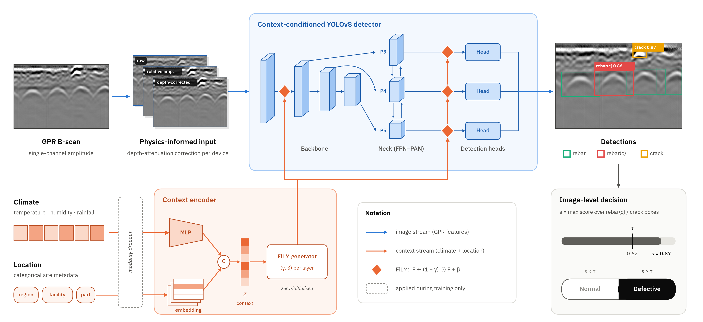

# 공간지능 및 멀티모달 AI 기반 다중 사회기반시설 진단·유지관리 기술 개발

## 1차년도 모델 — 멀티모달 GPR 이상 탐지 모델 (가제)

GPR B-scan 영상에 탐사 당시 **기상**과 **위치** 정보를 함께 넣어, 콘크리트 구조물(건축·교량·옹벽·터널)의 결함(결함 철근, 균열)을 검출하고 이미지 한 장을 **정상 / 불량**으로 판정하는 모델입니다.

- 학습·평가 데이터: AI-Hub **「도로·지상 시설물 안전 관리를 위한 GPR 데이터」(076)** 중 20,000장

---

## 1. 최종 결과

처음 보는 구조물 8곳으로 이루어진 test 3,000장(정상 2,100 · 불량 900) 기준입니다.

| 지표 | 값 |
|---|---:|
| **이미지 단위 F1 Score** | **88.33%** |
| Precision / Recall | 85.61% / 91.22% |
| Accuracy / AUROC | 92.77% / 0.963 |
| 박스 mAP50 / mAP50-95 | 0.905 / 0.741 |

이미지 판정 규칙: 결함(`rebar(c)`·`crack`) 박스 신뢰도의 최댓값이 τ = 0.62 이상이면 불량 (τ는 val에서 F1이 최대인 값).

## 2. 모델 구조



| 구성 | 내용 |
|---|---|
| 검출기 | YOLOv8s (COCO 사전학습에서 시작, 전체 미세조정). 파라미터 11,232,767개 |
| GPR 입력 (phys3) | 3채널: 원본 흑백 / 상대 진폭 / 장비별 깊이 감쇠를 보정한 상대 진폭 |
| 기상 입력 | 기온, 습도, 당일·1일 전·2일 전 강수, 선행강우지수 + 결측 표시 → 12차원 → MLP |
| 위치 입력 | 지역·시설·부위 임베딩 → 16차원 |
| 결합 방식 | 기상·위치 벡터로 YOLO 층 2·15·18·21 특징 맵을 FiLM(`y' = y × (1 + γ) + β`)으로 보정 |
| 결측 대비 | 학습 중 기상·위치를 각각 30% 확률로 지움 (ModDrop). 기상·위치가 없어도 예측 가능 |
| 출력 클래스 | `rebar` 정상 철근, `rebar(c)` 결함 철근, `crack` 균열 |

## 3. 학습 설정

| 항목 | 값 |
|---|---|
| 데이터 분할 | train 14,000 / val 3,000 / test 3,000 (구조물 단위 분할, 시설마다 3,500 / 750 / 750) |
| 입력 크기 / 배치 | 512 × 512 / 32 |
| epoch | 60 (조기 종료 없음), best epoch 41 (val mAP50-95 기준) |
| 옵티마이저 | SGD (lr0 0.01, lrf 0.01, momentum 0.937, weight decay 0.0005), cosine, warmup 3 epoch, AMP |
| 증강 | 좌우 반전 0.5, 이동 ±5%, 크기 ±15% (상하 반전·회전·색·모자이크·믹스업 없음) |
| 표집 | 현장 균형 가중 표집 (방문 이미지 수^−0.5) |
| 손실 | YOLOv8 기본 (분류 BCE, 박스 CIoU, DFL) |
| 시드 | 2026, deterministic |
| 학습 시간 | 약 4.8시간 (NVIDIA H200 1장) |
| 추론 | 신뢰도 하한 0.001, NMS IoU 0.5, 이미지당 최대 검출 100개 |

모든 설정은 [`code/config.yaml`](code/config.yaml)에 있습니다.

---

## 4. 설치

**필요 환경**: Linux + NVIDIA GPU (CUDA), Python 3.11

```bash
git clone https://github.com/JoonDol/infra_anomaly_detection.git
cd infra_anomaly_detection/1-year/2.model

python3.11 -m venv .venv
source .venv/bin/activate
pip install -r requirements.txt
```

테스트한 버전: PyTorch 2.11.0 (CUDA 12.8), Ultralytics 8.4.166, NumPy 2.4.6, scikit-learn 1.9.1, OpenCV 4.14.0, pandas, PyYAML, pycocotools

## 5. 데이터 구성

AI-Hub 「도로·지상 시설물 안전 관리를 위한 GPR 데이터」(076)에서 20,000장을 골라 학습·검증·평가에 썼습니다. AI-Hub 데이터는 재배포가 제한되어 이미지·라벨은 이 저장소에 없으며, [AI-Hub](https://www.aihub.or.kr)에서 직접 받아야 합니다.

### 5.1 원본과 정제

- **원본**: GPR B-scan 크롭 270,337장 (512×512 흑백 PNG + JSON 박스 라벨)
- **클래스**: `rebar` 정상 철근, `rebar(c)` 결함 철근, `crack` 균열
- **이미지 상태**: 양품(정상) / 불량. 불량은 결함 철근(`real_c1`), 균열(`crack`), partial 결함 철근(`partial_c1`)으로 나뉩니다.
- **장비**: 시설과 1:1 대응 (CT: 건축·옹벽, HM: 터널, NM: 교량)
- **정제 기준**: 2023년 촬영, 기온 ≤ 45℃, 습도 ≥ 10%. 양품이면서 partial 표기인 것과 결함 박스가 없는 불량은 제외 → 269,595장

### 5.2 분할 방법: 구조물 단위

- **구조물** = 시설 + 지역 (예: 대전 옹벽). 메타데이터에 건물 단위 ID가 없어 이것이 가장 굵은 묶음입니다.
- 같은 구조물의 이미지는 촬영일이 달라도 **train·val·test 중 한 곳에만** 둡니다. 따라서 val·test는 모두 **학습 때 보지 못한 구조물**입니다.
- 구조물 배정은 시드 2026으로 섞은 순서 중 다음 조건을 처음 만족하는 것을 썼습니다(성능을 보고 바꾸지 않음).
  - val·test마다 결함 철근과 균열(교량 제외)이 포함될 것
  - 시설별 할당량을 채울 수 있을 것
  - val·test의 지역이 train에도 등장할 것

| 시설 | train 구조물 | val 구조물 | test 구조물 |
|---|---|---|---|
| 건축 | 대전, 광주, 전북, 전남, 부산, 대구, 울산, 경북 (8) | 경기, 충남 | 서울, 강원 |
| 교량 | 서울, 경기, 충북, 광주, 대구, 경남 (6) | 대전, 강원 | 전남, 경북 |
| 옹벽 | 충북, 충남, 광주, 전남, 부산, 울산, 경북, 강원 (8) | 서울, 경기 | 대전, 전북 |
| 터널 | 서울, 충남, 경북, 강원 (4) | 경기, 충북 | 광주, 전북 |

### 5.3 구성

| 분할 | 장수 | 구조물 | 방문 | 스캔 | 정상 : 불량 | 용도 |
|---|---:|---:|---:|---:|---|---|
| train | 14,000 | 26 | 56 | 3,666 | 7,000 : 7,000 | 가중치 학습 |
| val | 3,000 | 8 | 21 | 1,739 | 2,100 : 900 | best epoch 선택, τ 결정 |
| test | 3,000 | 8 | 25 | 1,455 | 2,100 : 900 | 최종 평가 (1회) |

시설마다 train 3,500 / val 750 / test 750장입니다.

| 분할 | 시설 | 정상 | 결함 철근 | 균열 | partial 결함 철근 |
|---|---|---:|---:|---:|---:|
| train | 건축 | 1,750 | 117 | 954 | 679 |
| train | 교량 | 1,750 | 1,488 | 0 | 262 |
| train | 옹벽 | 1,750 | 874 | 614 | 262 |
| train | 터널 | 1,750 | 251 | 711 | 788 |
| val | 건축 / 교량 / 옹벽 / 터널 | 525씩 | 36 / 151 / 106 / 63 | 74 / 0 / 74 / 74 | 115 / 74 / 45 / 88 |
| test | 건축 / 교량 / 옹벽 / 터널 | 525씩 | 36 / 151 / 106 / 61 | 74 / 0 / 74 / 76 | 115 / 74 / 45 / 88 |

**뽑는 방법**
- val·test의 불량은 시설별로 정한 결함 종류 비율(결함 철근 : 균열 : partial — 건축 16:33:51, 교량 67:0:33, 옹벽 47:33:20, 터널 28:33:39)을 따랐습니다.
- train은 검출기 학습을 위해 결함 철근·균열을 우선했고, 원본에 모자란 종류는 다른 결함 종류나 partial로 채웠습니다.
- 스캔을 무작위 순서로 돌아가며 한 장씩 뽑아 스캔 다양성을 높였고, 같은 원본 프레임에서 가로 구간이 50% 넘게 겹치는 크롭은 제외했습니다.
- test는 시드 10으로 추출했고, train·val과 겹치는 이미지는 0장입니다.
- 교량은 원본에 균열 영상이 거의 없어(3장) 결함 철근 위주로 구성됩니다.

### 5.4 데이터셋 폴더 구성 

내려받은 원본에서 위 구성대로 이미지와 라벨을 아래처럼 두면 됩니다. 20,000장의 파일 이름과 분할, 기상·위치 정보는 [`data_split/manifest.csv`](data_split/manifest.csv)에 있습니다.

```
data/
├── images/{train,val,test}/*.png
└── labels/{train,val,test}/*.json   (AI-Hub 원본 JSON 그대로)
```

## 6. 실행

모든 명령은 `code/` 폴더에서 실행합니다. 경로는 `code/config.yaml`의 `paths`에 상대 경로로 들어 있으며, 5.4절 구조로 데이터를 두었다면 고칠 필요가 없습니다.

```bash
cd code
export CUDA_VISIBLE_DEVICES=0   # 쓸 GPU 번호
```

### 6.1 Pre-trained 가중치로 평가하기

학습된 가중치 [`weights/best.pt`](weights/best.pt)로 val·test를 예측하고 지표를 계산합니다. (H200 기준 약 20분)

```bash
# 가중치를 작업 폴더에 놓기
mkdir -p ../work/detectors/GCL/weights
cp ../weights/best.pt ../work/detectors/GCL/weights/

python s1_prepare.py                       # phys3 입력 영상, YOLO 라벨, 기상·위치 벡터 생성 → ../work/prepared 등
python s3_predict.py --exp GCL             # val·test 박스 예측 → ../work/preds/GCL
python s4_evaluate.py --exp GCL --test     # τ 결정, 지표 계산 → ../work/eval/report.md
```

`../work/eval/report.md`에서 F1 88.33%가 나오면 정상입니다.

### 6.2 처음부터 학습하기

```bash
python s1_prepare.py
python s2_train.py --exp GCL              
python s3_predict.py --exp GCL
python s4_evaluate.py --exp GCL --test
```

- 시작 가중치 `yolov8s.pt`(COCO 사전학습)는 처음 실행할 때 Ultralytics가 자동으로 내려받습니다.
- 배치 32에서 GPU 메모리가 부족하면 자동으로 16으로 줄입니다.
- 비교 실험도 같은 방식으로 돌릴 수 있습니다: `--exp base_gray3` (GPR 흑백만), `--exp G` (phys3만).

### 6.3 빠른 동작 확인 (스모크 테스트)

전체를 돌리기 전에 분할당 64장, 2 epoch로 처음부터 끝까지 동작하는지 확인합니다. 결과는 `../work/smoke/`에만 저장됩니다.

```bash
bash run_smoke.sh
```

### 6.4 단위 테스트

```bash
python -m pytest -q tests
```


## 7. 폴더 구조

```
2.model/
├── README.md
├── LICENSE                 AGPL-3.0 전문
├── requirements.txt
├── assets/                 README 그림
├── code/
│   ├── config.yaml         경로·하이퍼파라미터
│   ├── care_model.py       상황 인코더, FiLM 층, 모델 정의
│   ├── s1_prepare.py       입력 준비 (phys3 영상, YOLO 라벨, 기상·위치 벡터)
│   ├── s2_train.py         학습
│   ├── s3_predict.py       예측 (기상·위치 결측·뒤섞기 조건 포함)
│   ├── s4_evaluate.py      τ 결정, 이미지·박스 지표, 부트스트랩 신뢰구간, 보고서
│   ├── common.py, metrics.py
│   ├── run_care.sh         s1 → s4 전체 실행
│   ├── run_smoke.sh        스모크 테스트
│   └── tests/
├── data_split/
│   ├── manifest.csv        20,000장 목록 (분할, 시설, 결함 종류, 기상, 원본 위치)
│   └── split_structures.json  분할별 구조물 목록
├── weights/
│   └── best.pt             학습된 가중치 (22MB)
├── data/                   (직접 준비, 저장소에 없음)
└── work/                   (실행 결과, 저장소에 없음)
```

## 8. 출처 및 라이선스

- 데이터: AI-Hub 「도로·지상 시설물 안전 관리를 위한 GPR 데이터」(076), 과학기술정보통신부·한국지능정보사회진흥원(NIA)
- 검출기: [Ultralytics YOLOv8](https://github.com/ultralytics/ultralytics) (AGPL-3.0)
- 라이선스: **AGPL-3.0** ([`LICENSE`](LICENSE)). 이 코드와 학습된 가중치(`weights/best.pt`)는 AGPL-3.0 라이선스인 Ultralytics YOLOv8을 기반으로 상황 인코더·FiLM 층 등을 추가해 수정한 것으로, 같은 라이선스를 따릅니다.

## 9. 인용 및 사사

이 모델이나 코드를 사용했다면 아래와 같이 인용해 주세요.

```bibtex
@misc{dxlab2026gprmodel,
  title        = {Multimodal GPR Anomaly Detection Model with Weather and Location Context (Year 1)},
  author       = {{Data eXperience Laboratory, Sungkyunkwan University}},
  year         = {2026},
  howpublished = {\url{https://github.com/dxlabskku/infra_anomaly_detection/tree/main/1-year/2.model}},
  note         = {Supported by KAIA grant funded by the Ministry of Land, Infrastructure and Transport (RS-2026-25523576)}
}
```

본 연구는 국토교통부/국토교통과학기술진흥원의 지원(협력거점형 국토교통 국제협력 연구개발사업, 과제번호 RS-2026-25523576)으로 수행되었습니다.

This study was supported by the Korea Agency for Infrastructure Technology Advancement (KAIA) grant funded by the Ministry of Land, Infrastructure, and Transport (RS-2026-25523576).

> 이 연구개발내용을 대외적으로 발표할 때에는 반드시 국토교통부(국토교통과학기술진흥원)에서 시행한 국토교통과학기술 연구개발사업의 결과임을 밝혀야 한다.

## 10. 문의

질문이나 오류 제보는 저장소 [Issues](https://github.com/dxlabskku/infra_anomaly_detection/issues)에 남겨 주세요. (성균관대학교 Data eXperience Laboratory)
